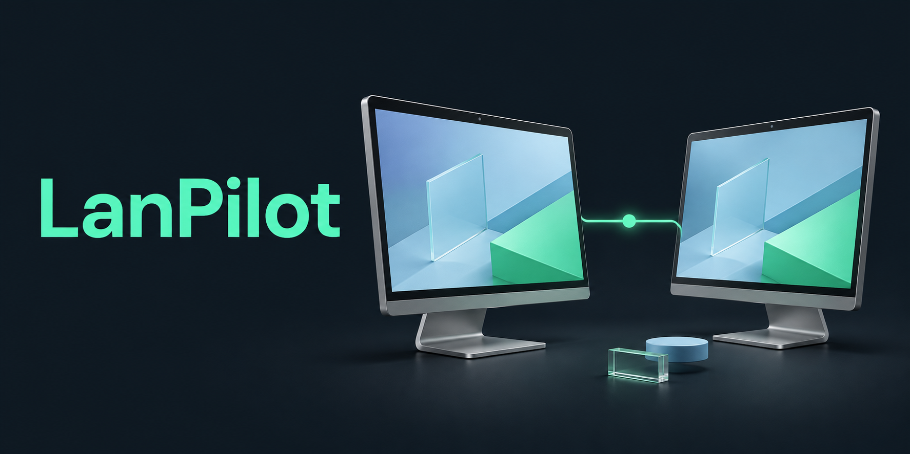

# LanPilot

[繁體中文](README.md) · [Documentation](doc/README.md) · [Engineering study guide (繁體中文)](doc/engineering-study-guide.zh-TW.md)



LanPilot lets a Windows computer view and control a Mac over a local network.
It combines native capture, persistent GPU framebuffers and custom snapshot/RECT
transactions, while retaining hardware H.264. Other host/client combinations
are not implemented. The cover is a conceptual illustration, not a claim of
additional platform support.

## Current architecture

**One desktop connection, two TLS channels, optional SSH workspace access.**

| Channel | Payload | Product behavior |
| --- | --- | --- |
| Visual TLS | H.264 or exact snapshots/rectangles | One remote desktop view |
| Control TLS | Input, framebuffer ACKs, recovery and opt-in text clipboard | Input and clipboard require separate grants |
| Independent SSH | Commands, builds and file tools | Used when needed; desktop control does not imply shell access |

Visual and control use separate sockets to the same service port, bound to one
desktop session. Users do not configure three independent connection profiles.
Updates preserve pairing, permissions and the selected visual mode; an existing
Exact-only connection must not silently become H.264 or legacy SSH.

The Windows window can be resized from every edge or maximized. The remote image
stays centered and proportional, with black bars in unused space. `Ctrl+F` selects
Fit; `Ctrl+1` selects 1:1. Emergency input release: `Ctrl+Alt+Shift+F12`.
Mac-native IME handles composition. Text clipboard synchronization requires
explicit opt-in; image and file clipboard are not provided.

Read the [architecture decision](doc/architecture.md) for tradeoffs. Separate
connections do not eliminate all contention. A commit ACK confirms canonical
framebuffer state, not physical monitor scan-out.

## Installation and testing

Installer builders and a personal route for already-paired computers exist.
**There is no downloadable release that has passed all public-release acceptance
gates yet.** Never distribute a developer's keys, certificates or personal profile
as another user's setup material.

- **An existing paired Windows/Mac installation:** use its
  [personal installers](doc/personal-installers.md), then open the single Windows
  **LanPilot** shortcut and connect to the remembered computer. No certificate
  entry is needed; native OS consent may still be required.
- **A new computer/account:** do not use someone else's personal package.
  Native pairing, installation and update code exists, but complete clean-account
  acceptance, production signing and notarization remain separate gates.
- **macOS consent:** Screen Recording is needed for desktop capture and
  Accessibility for input. The app must not approve these silently. Testing the
  existing-pair personal route does not require buying an Apple Developer
  membership or disabling security checks.

[Product status](doc/product-status.md) · [Convergence checklist](doc/release-convergence.md) ·
[Install/update acceptance](doc/install-once-release-acceptance.md)

## Preserved version lines

| Line | Architecture | Role |
| --- | --- | --- |
| v0.1 | H.264 + SSH | Historical baseline |
| v0.2 | Snapshots/RECT + SSH, with H.264 available | Historical evolution |
| v0.3 | Visual TLS + control TLS; Agent SSH | Current development and product-convergence line |

These describe evolution, not three accepted release tags. The previous public
source remains in the [historical branch](https://github.com/HayronHgh/LanPilot/tree/legacy/pre-convergence-20261115)
and existing commits. Private research history is not imported. The
[legacy SSH installation guide](doc/desktop-preview-install.md) remains available
for explicitly selected compatibility use.

## Build and verify

Use CMake 3.25+, a C++23 compiler and native SDKs. On Windows, use a configured
Visual Studio development environment. The Mac installer requires universal2:

```sh
# Windows
cmake -S . -B build/dev -DRWN_BUILD_TESTS=ON

# macOS
cmake -S . -B build/dev -DRWN_BUILD_TESTS=ON "-DCMAKE_OSX_ARCHITECTURES=arm64;x86_64" -DCMAKE_OSX_DEPLOYMENT_TARGET=13.0

# After configuring on the selected platform
cmake --build build/dev --config Release --parallel 4
ctest --test-dir build/dev -C Release --output-on-failure
```

CI covers Windows/MSVC and Mac universal2. Workflow/security tests and native
package probes do not replace human display/input, restart/update, soak or
physical input-to-photon acceptance. Follow the [build/package guide](doc/public-guide.md)
to stage the product component; do not distribute a development directory.

## License

Personal, non-commercial use is free. Commercial use, including company work and
freelance services, requires prior written permission from **HayronHgh**. See
[LICENSE](LICENSE). This is source-available software, not an unrestricted
open-source license.

[Contributing and English commit conventions](CONTRIBUTING.md)
