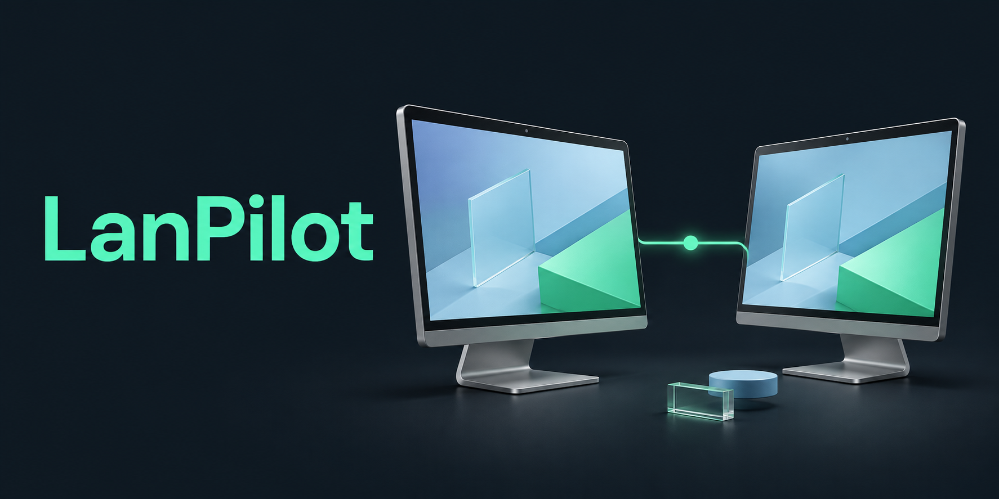

# LanPilot

[English](README.en.md) · [文件索引](doc/README.md) · [工程學習與技術答辯](doc/engineering-study-guide.zh-TW.md)



在區域網路上，從 Windows 操作 Mac。LanPilot 使用原生桌面擷取、持久化 GPU
framebuffer 與自研 snapshot／RECT 交易，並保留硬體 H.264。其他主機／用戶端
方向尚未實作；封面是產品概念圖，不代表額外平台支援。

## 最新主線

**一個桌面連線、兩條 TLS 通道，SSH 工作連線按需使用。**

| 通道 | 用途 | 使用者操作 |
| --- | --- | --- |
| 畫面 TLS | H.264 或無損 snapshot／RECT | 在同一個 LanPilot 連線中呈現 |
| 控制 TLS | 鍵鼠、framebuffer ACK、恢復訊息、選用文字剪貼簿 | 控制與剪貼簿分別授權 |
| 獨立 SSH | 命令、建置與檔案工具 | 有工作需求時才使用；不由桌面控制權限推導 shell 權限 |

畫面與控制使用獨立 socket、共用服務埠與桌面 Session；不是三套供使用者填寫的
連線設定。連線成功後記憶設定；更新必須保留既有配對、權限選項和畫面模式，
不把已選用的 Exact-only 自動改回 H.264 或舊 SSH 路徑。

Windows 視窗可從四邊調整或最大化；影像等比例置中，剩餘空間留黑邊。
`Ctrl+F` 選 Fit，`Ctrl+1` 選 1:1。緊急釋放輸入：`Ctrl+Alt+Shift+F12`。
原生 Mac IME 由 Mac 處理；文字剪貼簿需明確開啟，不含圖片或檔案剪貼簿。

詳見 [架構與取捨](doc/architecture.md)。獨立通道不保證消除所有阻塞；
ACK 代表 canonical framebuffer 已提交，不代表實體螢幕已完成顯示。

## 安裝與測試

目前提供可建置的安裝器與既有配對的個人安裝路線，**尚無通過完整公開發布驗收的
下載版**。不要把某台電腦的憑證、設定或私鑰當成一般使用者的安裝素材。

- **已配對的兩台電腦：**使用該組電腦的 [個人安裝器](doc/personal-installers.md)，
  安裝後從 Windows 的唯一 **LanPilot** 捷徑開啟，確認記憶的電腦後 Connect。
  不需要再貼憑證資料；OS 仍可能要求本機權限確認。
- **新電腦／新帳號：**不要套用別人的個人安裝包。首次配對、原生安裝與更新
  程式已存在，但完整乾淨環境驗收、正式簽章與公證仍是獨立缺口。
- **macOS 權限：**顯示桌面需要螢幕錄製，控制需要輔助使用；不能靜默代按允許。
  個人既有配對版不以購買 Apple Developer 會籍作為測試前提，也不關閉安全檢查。

[目前狀態](doc/product-status.md) · [發布收斂清單](doc/release-convergence.md) ·
[一次安裝／更新驗收](doc/install-once-release-acceptance.md)

## 保留的版本線

| 版本線 | 架構 | 定位 |
| --- | --- | --- |
| v0.1 | H.264 + SSH | 歷史基線 |
| v0.2 | snapshot／RECT + SSH | 歷史演進，保留 H.264 能力 |
| v0.3 | 畫面 TLS + 控制 TLS；Agent SSH | 最新開發與產品收斂主線 |

這些是演進路線，不代表三個已驗收的 Release 標籤。舊的公開來源保存在
[歷史分支](https://github.com/HayronHgh/LanPilot/tree/legacy/pre-convergence-20261115)
和既有 commit 中；私人研究歷史不匯入 GitHub。舊 SSH 預覽的
[相容安裝說明](doc/desktop-preview-install.md) 保留供明確選用。

## 建置與驗證

需要 CMake 3.25+、C++23 編譯器與平台 SDK。Windows 可使用 Visual Studio 的
開發環境；Mac 安裝器需要 universal2，因此 macOS 使用以下 configure：

```sh
# Windows
cmake -S . -B build/dev -DRWN_BUILD_TESTS=ON

# macOS
cmake -S . -B build/dev -DRWN_BUILD_TESTS=ON "-DCMAKE_OSX_ARCHITECTURES=arm64;x86_64" -DCMAKE_OSX_DEPLOYMENT_TARGET=13.0

# 在各自平台 configure 後
cmake --build build/dev --config Release --parallel 4
ctest --test-dir build/dev -C Release --output-on-failure
```

CI 驗證 Windows/MSVC 與 Mac universal2；workflow、安全測試與原生套件探針
不取代人工輸入／顯示、重啟／更新、長測與 physical input-to-photon 驗收。
請依 [建置與封裝指南](doc/public-guide.md) 選擇產品 component，不要直接分享開發目錄。

## 授權

個人非商業使用免費；商業使用（包含公司業務與接案）需事先取得作者
**HayronHgh** 的書面授權。詳見 [LICENSE](LICENSE)。這是 source-available
專案，不是允許任意商業使用的開源授權。

[貢獻與英文 commit 規範](CONTRIBUTING.md)
