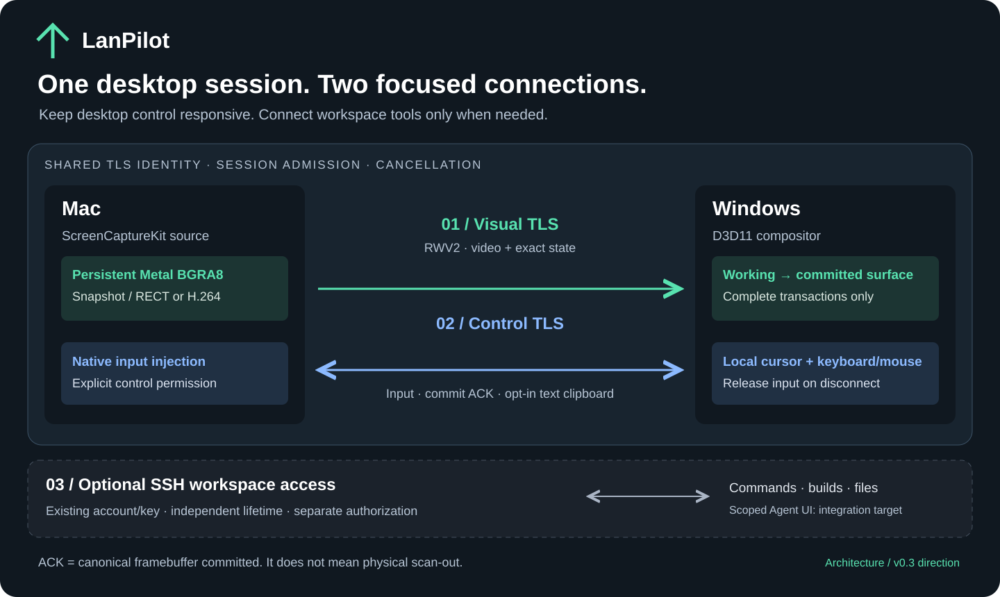

# One desktop session, optional SSH work

This is the architecture decision for release convergence. It distinguishes
implemented mechanisms from product acceptance. It does not promote an
experimental visual mode or claim a new latency result.

## Decision

Keep two independently buffered TCP/TLS connections for the desktop, bound to
one authenticated desktop session. Use the existing SSH service only when a
user or authorized tool needs remote workspace operations. Ordinary desktop
viewing must not depend on an SSH session being alive.

The product presents one remembered computer and one Connect action. Visual and
control sockets are internal details, not separate profiles or permissions the
user must configure. Screen viewing, input, clipboard and Agent operations are
distinct grants; a successful socket handshake does not grant all of them.

| Plane | Payload | Connection / lifetime | Owner in current source |
| --- | --- | --- | --- |
| Visual | RWV2 H.264, full snapshots, exact rectangles and state transitions | Desktop TLS socket; shares admission and cancellation with control | `desktop-agent/tls_preview.hpp`, `viewer/tls_preview.hpp` |
| Control | RWC1 input, canonical framebuffer ACKs, recovery requests; opt-in text clipboard | Separate desktop TLS socket to the same listener port | `viewer/main.cpp`, `desktop-agent/main.cpp` |
| Workspace | Commands, builds and file operations explicitly requested through SSH tools | Independent SSH connection, created when needed | Existing OS SSH service; not a third desktop TLS role |

The two desktop wrappers each hold an array of two channels. Their shared
admission is defined in `transport/include/rwn/transport/channel_session.hpp`.
SSH login works independently; a fully integrated, workspace-scoped Agent
product must not be inferred from that capability. See the
[engineering study guide](engineering-study-guide.zh-TW.md).

## Why keep separate visual and control connections?

A snapshot is a bulk transfer, while a mouse-button edge or exact commit ACK
has a small payload and a latency-sensitive deadline. Separate application
queues, socket buffers and cancellation paths let these workloads be scheduled
independently. Agent build output must not own the desktop writer or its locks.

This is isolation, not a measured speed guarantee. Both connections still share
the LAN, CPU, memory bandwidth and OS scheduling. TCP ordering still applies
within each connection. Also, a single TCP connection is full duplex: outbound
visual bytes do not inherently sit ahead of reverse-direction input bytes in
one queue. Comparing architectures requires a workload experiment, not merely
counting sockets. The historical ACK improvement came from removing synchronous
framebuffer readback/hash work before ACK creation, not from socket count.

Control currently includes text clipboard. Its writer selects input before a
pending clipboard message, but a message already being written is not preempted.
Measure large-text transfer against input/ACK tails before claiming complete
isolation. Do not put general file payloads on this writer. Independent SSH
file transfers should also be rate-limited when competing with desktop traffic.

## Simplification boundaries

1. **One configuration owner:** remember the peer and protected identity
   references once; never ask users to configure visual and control separately.
2. **One desktop lifetime:** authenticate both sockets, then admit input. If
   either fails, cancel the sibling and release pressed input. Reconnect creates
   a new session, decoder/framebuffer state and input epoch. It must not replay
   old key events or silently re-enable clipboard synchronization.
3. **Optional workspace access:** desktop control does not confer shell rights.
   SSH stays independent; disconnecting it must not freeze the remote desktop.
4. **One installed entry per OS:** one launcher, one supported install location,
   protected state outside replaceable program files. Preserve working legacy
   state until migration and rollback have been verified.
5. **Explicit release selection:** package from the allowlisted source export.
   Keep research logs, private profiles, keys and Git history local. Keep useful
   historical v0.1/v0.2 sources in version control, not duplicate user shortcuts.

Do not remove the SSH compatibility implementation merely because direct TLS
exists: personal installations and rollback can still depend on it. Its removal
requires a call-site/package audit plus a successful replacement installation.
Do not introduce a new transport, cryptographic scheme or generic scheduler to
achieve this cleanup.

## Visual correctness contract

- SCK buffers are temporary sources, not retained exact bases. Persistent
  Metal-owned resources hold canonical BGRA8 source/base/target pixels.
- Exact means byte equality in the canonical format. It is not a perceptual
  threshold and does not imply equality with a color-managed physical monitor.
- Snapshot/rect transfers update a Windows working texture. Only a complete,
  validated transaction can replace the committed texture.
- ACK means canonical framebuffer commit, not `Present`, scan-out or photon time.
- Session, representation epoch and frame/base IDs serve different purposes.
  Stale callbacks and ACKs cannot restore a cancelled epoch.
- Returning from exact to video cancels incompatible work and requires a fresh
  video epoch/IDR. A previous P-frame must not become an accidental recovery base.
- Latest wins during motion; the final valid state must drain without another
  input or capture event. Compressed reference-dependent frames cannot be dropped
  as if they were independent cursor positions.

## Release gates and next evidence

| Gate | Required evidence |
| --- | --- |
| Source closure | Export includes every build/test/installer resource; no private state/history; exact manifest hashes |
| Native build | Windows and Mac build/CTest from the same exported source; record commit and toolchains |
| Installation | Install, relaunch, update, rollback and uninstall on the supported personal pair; settings/keys preserved |
| Desktop lifetime | Offline start, rapid reopen, disconnect, sleep/reconnect, close with no owned process left behind |
| Correctness | Snapshot/rect hash probes, stale-epoch rejection, final generation convergence, input release |
| Performance | Same workload/mode/resolution: p50/p95/p99 input and ACK, callback-to-present, bandwidth, queue depths, exact residency |
| Public claims | Separate automated evidence, human observations, unrun gates and signed production distribution |

Native signing/notarization and clean-machine first-pair acceptance remain
separate from the explicitly requested personal, existing-pair installers.
Neither route permits disabling trust checks or silently granting OS consent.

See [product status](product-status.md), [personal installers](personal-installers.md)
and [release acceptance](install-once-release-acceptance.md). Historical reports
do not replace acceptance of the exact candidate being published.
