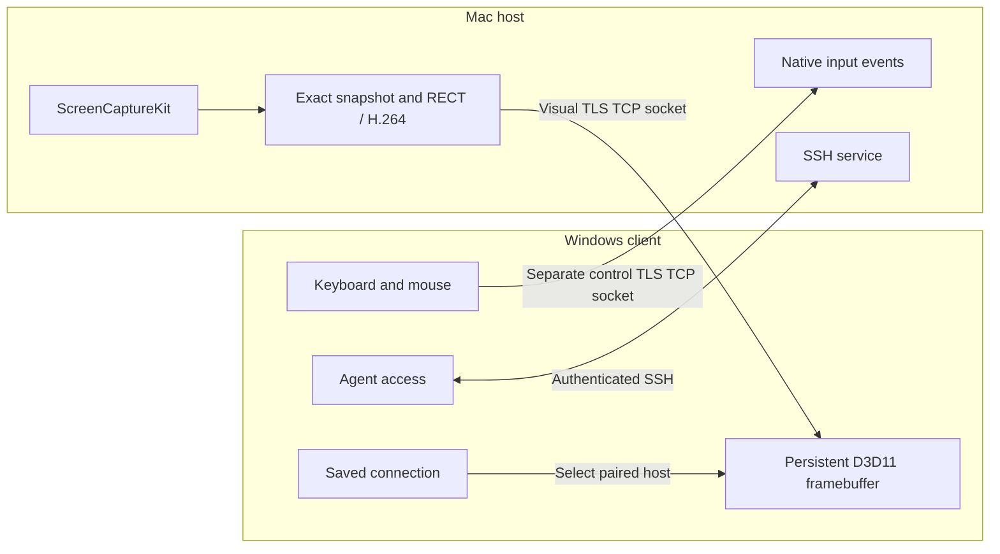
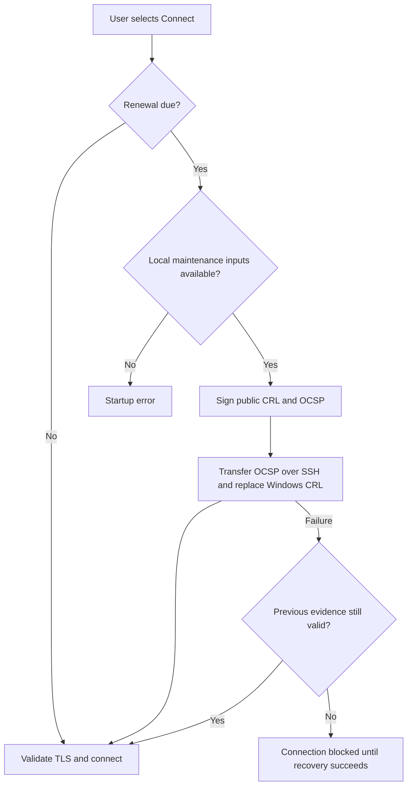
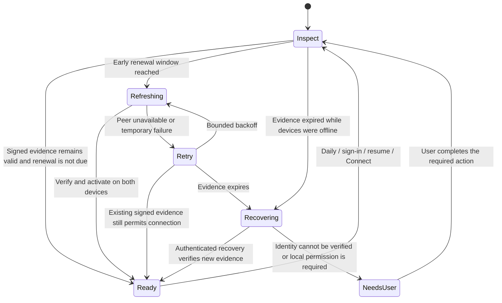
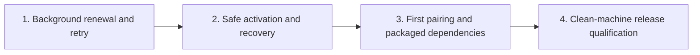

# Connection reliability and release roadmap

Updated: 2026-10-19. [繁體中文](connection-reliability.zh-TW.md)

The product goal is simple: enter an address, approve the first pairing on both devices, then press **Connect** on later visits. Device identity, renewal, retries, and recovery belong to LanPilot. Operating-system permission prompts still require the user's consent.

This document distinguishes the published source, the installed development build, and planned work. It does not announce a release or completion of background renewal.

## 1. Connection architecture

Visual and control sockets currently share a TLS listener port. SSH is the third logical channel. Successful socket establishment proves transport connectivity; it does not prove that a framebuffer is updating, input works, or physical display latency meets a target. A framebuffer commit ACK is distinct from Present and monitor scan-out.

## 2. Why the installed build can still fail at startup

The installed development build renews signed public revocation evidence when the user launches TLS. It currently issues evidence for seven days and schedules its next check for day six. No background task was found during the 2026-10-19 audit. A machine left unused beyond expiry must recover during the next connection attempt.

Input validation currently occurs before the renewal failure handler. A missing input can therefore abort startup even when a retry would be more useful. The generic message does not identify the missing component. A renewal also restarts the Mac listener, which needs an explicit session policy before periodic background activation is safe.

The reported `Trust renewal input is missing` error was not reproduced in the real user context on 2026-10-19. All checked inputs existed, and running the installed renewal tool succeeded. The cause of that particular missing-input report remains unresolved; renewal success is not proof that it was fixed.

## 3. Evidence and remaining gaps

| Capability | Evidence / status | Release implication |
| --- | --- | --- |
| Separate visual/control TLS sockets; Agent SSH | Present in published development source; installed build has connected on two TLS sockets | Keep three channel roles explicit |
| Product data layout and on-launch renewal | Installed development changes; not included in this documentation-only public commit | Export and validate code as its own change |
| Signed CRL/OCSP refresh | Installed run on 2026-10-19 reported success; evidence valid until 2026-10-26 | Point-in-time recovery, not continuous availability |
| Renewal tests | Earlier local build recorded 4/4 CTest; renewal workflow covers current/due/disabled/invalid-window decisions | Does not test background execution, crash recovery, or a clean install |
| Background schedule and retry state | Planned | Next implementation milestone |
| Self-contained setup | Still depends on a separately installed OpenSSL, a preconfigured SSH identity, and local authority state | Existing developer setup is not a clean-machine installer |
| First-time pairing and identity rotation | Product flow incomplete | Required before general distribution |

Historical local results are not acceptance results for the latest public commit. The code and binaries for each release must come from the same reviewed source.

## 4. Target renewal lifecycle — planned

The next implementation should inspect on sign-in, daily, after resume, and before Connect. Start renewal at least 72 hours before expiry for the current seven-day evidence policy. Use persisted retry state and a bounded schedule such as 1 minute, 5 minutes, 30 minutes, then 2 hours, with jitter. These are initial engineering values, not measured product defaults.

Transient failures should appear as a nonblocking status while current signed evidence remains valid. If evidence has expired, show **Updating secure connection** with a bounded attempt and a retry action. If verification cannot succeed, show a specific action such as re-pairing or granting an OS permission. Suppressing all errors or accepting expired evidence would not provide reliable recovery.

Recovery must have an independently authenticated route. The current installed setup can use its existing trusted SSH channel. The general product needs an explicit recovery design established during pairing; an expired TLS handshake cannot bootstrap its own trust. Designing that route must not grant desktop control before authentication succeeds.

Dates in a JSON manifest are advisory. Connection and renewal decisions must verify the actual signed artifacts, issuer, validity, and peer binding. Activation must preserve the previous committed state until both sides have validated the update. A crash or partial deployment must remain retryable.

## 5. Implementation order and review gates

Complete and review one milestone at a time.

| Milestone | Deliverable | Evidence required before completion |
| --- | --- | --- |
| 1. Background renewal and retry | User-scoped task/helper; typed status; input-specific diagnostics; deadline; concurrency lock; persisted backoff | Due renewal runs without opening Viewer; unreachable Mac retries; simultaneous Connect does not create two writers; valid evidence remains usable |
| 2. Safe activation and recovery | Verified staged artifacts, restart/session policy, durable transaction state, rollback/retry, expired-evidence recovery | Failures before/after each activation step do not corrupt trust; no silent termination; revoked or mismatched peers remain rejected |
| 3. First pairing and packaged dependencies | Both devices create their own protected keys; local confirmation; saved address; explicit unpair; no developer-specific executable/key paths | Fresh Windows/Mac accounts can pair and reconnect; upgrade preserves identity; required OS consent is clearly explained |
| 4. Release qualification | Public source, matching two-platform binaries, installer/update/uninstall, signing/notarization status | Same-commit builds/tests; artifact hashes; clean installs; input/render/reconnect regression; user acceptance and duration evidence |

CRL/OCSP policy, peer authorization records, device certificate expiry, and key rotation are separate design decisions. A device allowlist could be considered in a future architecture decision, but this roadmap does not change the current authentication policy.

## 6. Fault matrix and useful measurements

| Scenario | Expected observable behavior |
| --- | --- |
| Mac off or network unavailable for hours | Background retry; no modal loop; connect status explains that the peer is offline |
| Both devices unused longer than evidence validity | Authenticated recovery runs when reachable; no acceptance of expired evidence |
| OpenSSL/SSH/authority metadata missing | Identify the missing component and offer the appropriate repair action |
| Crash during transfer or local replacement | Last committed trust remains readable; next run resumes or retries |
| Two launches or task plus Connect | One maintenance transaction; other request observes its status |
| Clock change, revoked client, wrong peer, or invalid signature | Verification rejects the invalid state; diagnostic distinguishes clock trouble from identity failure |
| Renewal while a session is active | Apply the chosen session policy; no unexplained disconnect caused by listener restart |

Record last successful verification, verified expiry, next attempt, retry reason, transaction stage, and time to ready. Do not log input text or private key material. Bound log and backup retention.

Acceptance should include deterministic time/failure injection across at least two renewal cycles, followed by a real deployment crossing an expiry boundary. Simulated cycles do not replace the real duration check. Track connection success for reachable, legitimately paired devices and count renewal failures in that result. A TCP connection alone is insufficient: verify first framebuffer commit, continued updates, and control readiness.

See [release readiness](release-readiness.md), [the three version lines](public-releases.md), and [TLS setup boundaries](tls-setup-security.md).
