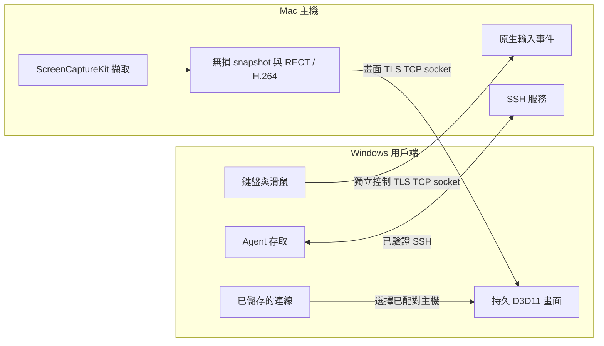
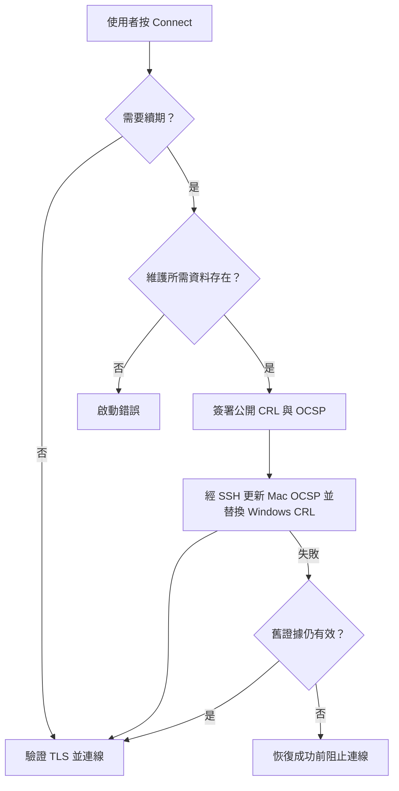
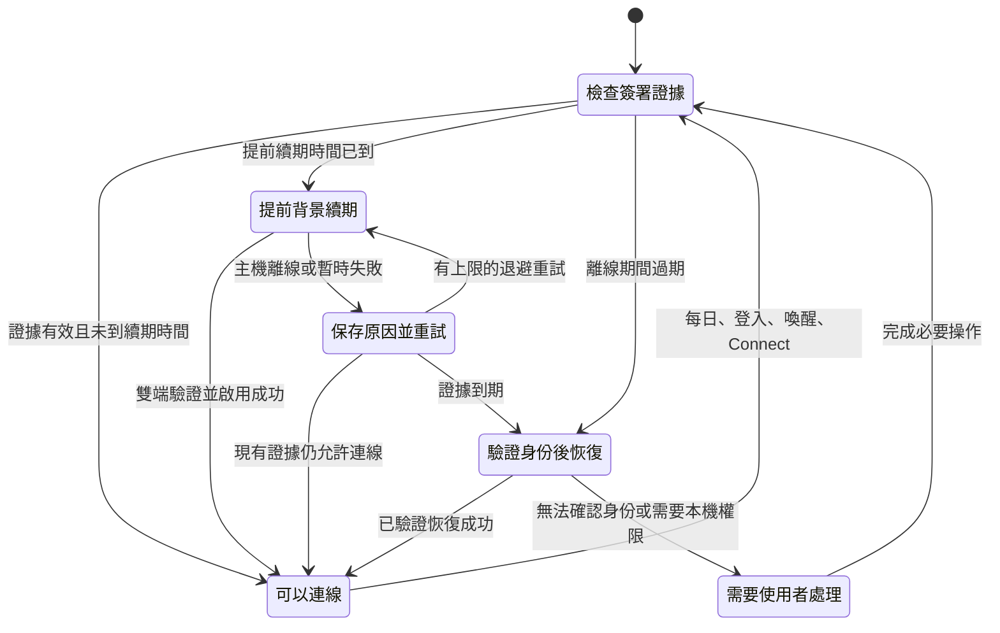

# 連線持續性與發布路線圖

更新：2026-10-19。[English](connection-reliability.md)

產品目標：首次輸入位址，在兩端確認配對；以後開啟 LanPilot，按 **Connect** 即可。身份、續期、重試和恢復由程式管理；作業系統的螢幕錄製與控制權限仍由使用者同意。

以下分別標示公開程式、本機安裝開發版和待開發項目。這份文件不代表正式 Release 或背景續期已完成。

## 1. 三個通道各自負責什麼

畫面與控制目前共用 TLS listener port，但各自使用獨立 socket；Agent 使用 SSH。兩條 socket 連上只證明傳輸建立，還需確認畫面提交、持續更新與輸入可用。Framebuffer commit ACK 與 Present、螢幕 scan-out 各有不同意義。

## 2. 為什麼現在仍可能開啟失敗

安裝開發版目前只在使用者啟動 TLS 時更新公開撤銷證據。證據有效七天，第六天進入續期時機；2026-10-19 檢查時沒有 LanPilot 背景排程。因此，兩台電腦閒置超過效期後，恢復工作會落在下一次連線當下。

目前輸入資料檢查位於續期失敗處理之外，資料遺失會直接中止啟動；錯誤也沒有指出是哪個元件。此外，續期會重啟 Mac listener，背景化之前必須先定義連線中的啟用策略。

2026-10-19 的「Trust renewal input is missing」在真實使用者環境未能重現：檢查的輸入都存在，直接執行續期成功。因此該次遺失訊息的原因仍待定位，不能把續期成功寫成根因已修復。

## 3. 已有證據與尚缺工作

| 項目 | 有據可查的狀態 | 對發布的影響 |
| --- | --- | --- |
| 畫面 TLS、控制 TLS、Agent SSH | 公開開發來源已有；安裝版曾建立兩條 TLS 連線 | 保持三個通道職責清楚 |
| 產品資料配置與啟動時續期 | 已有本機開發修改；本次公開文件提交不包含這批程式碼 | 後續獨立匯出、驗證來源 |
| CRL／OCSP 續期 | 安裝版 2026-10-19 成功，效期到 2026-10-26 | 證明當次恢復，尚未證明持續可用 |
| 測試 | 先前本機記錄 CTest 4/4；續期工作流測 current／due／disabled／錯誤時間範圍 | 尚未涵蓋背景執行、崩潰恢復、乾淨安裝 |
| 背景排程與持久重試 | 待開發 | 下一個里程碑 |
| 自包含安裝 | 仍依賴另裝的 OpenSSL、預先配置的 SSH 身份、本機 authority | 開發者環境不能當一般用戶安裝包 |
| 首次配對與身份輪替 | 產品流程未完成 | 一般分發前必須補齊 |

本機歷史測試不等於最新公開 commit 的驗收。正式套件必須由同一份已審查來源產出雙端程式。

## 4. 目標生命週期：待實作

初始工程方案：登入、每日、喚醒與 Connect 前檢查；目前七天政策至少提前 72 小時續期。失敗保存狀態，以 1 分鐘、5 分鐘、30 分鐘、2 小時為初始退避值，加入隨機偏移並限制重試。這些是待驗證參數。

舊證據有效時，暫時失敗顯示非阻塞狀態。已過期時，連線頁顯示「正在更新安全連線」，在有限時間內嘗試並提供重試；無法驗證身份才引導重新配對或完成 OS 授權。不能用隱藏所有錯誤或接受過期證據來代替恢復。

恢復必須有獨立驗證途徑。現有安裝可用原本已信任的 SSH；一般產品需在首次配對時建立恢復設計。已失效的 TLS 握手無法自行建立新的信任，恢復流程也不能提前取得桌面控制權。

JSON 記錄日期只供排程參考；程式仍須驗證真正簽署資料的有效期、簽發者與配對身份。啟用採可恢復交易，雙端更新失敗或程序崩潰時保留最後可讀狀態。

## 5. 一次完成一個里程碑

| 里程碑 | 交付內容 | 完成前必須取得的證據 |
| --- | --- | --- |
| 1. 背景續期與重試 | 使用者層級 task／helper、明確狀態、具體遺失診斷、逾時、單一 writer、持久退避 | 不開 Viewer 也會續期；Mac 離線會重試；task 與 Connect 同時發生不重複寫入；有效證據仍可用 |
| 2. 安全啟用與恢復 | 驗證暫存產物、listener 啟用策略、交易記錄、回復／重試、過期恢復 | 各階段故障不損毀信任；不無聲退出；已撤銷或身份不符仍被拒絕 |
| 3. 首次配對與依賴封裝 | 兩端自行建立受保護私鑰、本機確認、記憶位址、解除配對、去除開發者路徑 | 新 Windows／Mac 帳號能完成配對與重連；升級保留身份；清楚引導 OS 必要同意 |
| 4. 發布驗收 | 公開來源、對應雙端產物、安裝／更新／移除、簽章／公證狀態 | 同 commit build／CTest、SHA-256、乾淨安裝、輸入／畫面／重連回歸、人工與長測證據 |

CRL／OCSP 政策、裝置授權清單、身份憑證到期與金鑰輪替是不同決策。將來可以評估裝置 allowlist，但本規劃沒有修改目前驗證政策。

## 6. 必測故障與持續性指標

| 情境 | 期待行為 |
| --- | --- |
| Mac 關機或網路中斷數小時 | 背景重試、不反覆彈窗；連線頁清楚顯示主機離線 |
| 兩端停用超過證據效期 | 可達時執行已驗證恢復；不接受過期證據 |
| OpenSSL／SSH／authority 資料遺失 | 指出缺少元件並提供對應修復方式 |
| 傳輸或替換中崩潰 | 最後已提交信任可讀；下次繼續或安全重試 |
| 連續開兩次、背景續期與 Connect 同時發生 | 單一維護交易，其他要求讀取其狀態 |
| 系統時間改動、撤銷、錯誤配對或簽章 | 拒絕無效狀態，區分時鐘與身份問題 |
| 串流中續期 | 依已定義策略啟用，不能因 listener 重啟無預警斷線 |

記錄最後成功驗證、已驗證效期、下次嘗試、失敗原因、交易階段與 ready 耗時；日誌和備份設定容量上限，排除輸入文字與私鑰內容。

先用時間與故障注入覆蓋至少兩輪續期，再做真實部署跨越到期邊界。模擬不能代替真實長測。對可達且已正當配對的裝置計算連線成功率，續期失敗必須算入；連線驗收包含首個 framebuffer commit、持續更新與控制就緒。

相關入口：[發布就緒](release-readiness.md)、[三條版本線](public-releases.md)、[安裝與權限](tls-setup-security.md)。
